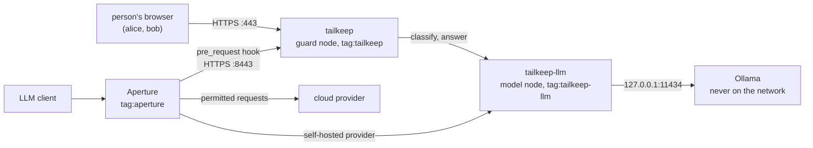

# tailkeep

tailkeep is a small Go program that checks text for secrets and sensitive content before it reaches a cloud model, and uses the caller's Tailscale identity to decide what happens next.

It joins your tailnet as two nodes. The guard (`tailkeep`) finds sensitive content and applies the policy of whoever is asking. The model node (`tailkeep-llm`) is a reverse proxy in front of a local Ollama, reachable only by callers the policy allows. People use the guard through a web app. Aperture can call it as a `pre_request` hook.

Users never log in and never hold a key. The tailnet tells tailkeep who is calling, and an app capability in the policy file says how that caller is to be treated.

tailkeep does not try to out-detect other tools. Its pattern detectors are a short fixed list. The part it adds is the wiring on Tailscale: callers are identified by the tailnet, policy lives in grants, the local model can be reached only over the tailnet, and Aperture can consult tailkeep before it forwards a request. Other tools are named under [Related tools](#related-tools).

## What you will see

With the example policy in [examples/policy.example.hujson](examples/policy.example.hujson), the same text containing a fake AWS key gives a different result for each caller:

| Caller | Result |
|---|---|
| `alice@example.com` (action `reroute`) | finding `aws_access_key`; the web app lets her ask the local model about the text, and the answer never leaves the tailnet |
| `bob@example.com` (action `block`) | finding `aws_access_key`; the text is not sent to any model for an answer |
| a device with no `llm` grant, calling the model node | `403`, naming the device |

## How it works



Every request to the web app, the hook and the model node follows the same order, written as one short function per entry point (`scan`, `answer`, `handle`, `ServeHTTP`):

1. Resolve identity. WhoIs on the connection gives the caller's login or tags, device name and the tailkeep capabilities it holds toward this node.
2. Load the policy from those capabilities (see [Policy reference](#policy-reference)).
3. Detect. The built-in detectors scan all of the text. If the policy has `model_check` on and no detector found anything, the local model also classifies the first 2,000 characters.
4. Decide. The policy turns findings and classification into one action.
5. Audit and respond. One audit line is written (never the text), then the answer is sent.

The four actions:

| Action | Cloud model | Local model |
|---|---|---|
| `allow` | receives the text as written | may receive it |
| `redact` | receives the text with every finding swapped for a `[REDACTED:<detector>]` marker | may receive it |
| `reroute` | receives nothing. The web app has the local model answer instead; through Aperture the request is refused with a note telling the sender to use the local model (see [Using it with Aperture](#using-it-with-aperture)) | may receive it |
| `block` | receives nothing | is not asked for an answer. The local classifier may still read the first 2,000 characters when `model_check` is on |

A note on `block`. "Block" means the text is not sent to any model for an answer. It does not mean no model reads it: when `model_check` is on, the local classifier reads the first 2,000 characters of the text to reach its decision, even for a caller whose action is `block`. That classifier, on this tailnet, is the only model that sees it. A caller who wants no model to see it at all can set `model_check` to `false` in their grant.

Running two nodes from one program gives each its own address, tags and grants. That lets the policy admit Aperture to the model node and nobody else, and lets the guard call the model node as an ordinary peer.

## Quick start

You need Go 1.27.1 or later (the version `tailscale.com` requires). Nothing else is needed for the first part.

### Offline: tests and the `check` command

```sh
go test ./...
```

The tests never need a network, a tailnet, Ollama or Aperture.

`check` reads text from standard input, runs the detectors and prints the decision for a policy action (`--action`, default `block`). It does not use the network and never prints the text it scanned. The key below is the public AWS documentation example, assembled in the shell so this file holds no key-like string:

```sh
printf 'aws_access_key_id = %s%s\n' AKIA IOSFODNN7EXAMPLE | go run ./cmd/tailkeep check --action block
```

```
findings: 1
  aws_access_key [20,40) AKIA…
decision: block (found aws_access_key)
```

The numbers are byte offsets. The preview shows at most four characters. With `--action redact` the decision line reads `decision: redact (found aws_access_key)`. Text with nothing in it gives `decision: allow (nothing found)`. `check` skips the local model, so `--action reroute` and `--action block` differ only in the action name.

### The full app

You need a tailnet with MagicDNS and HTTPS certificates enabled, Ollama running on the same machine, and permission to edit the tailnet policy file.

1. **Policy.** Merge the tags, grants and app grants from [examples/policy.example.hujson](examples/policy.example.hujson) into your policy file. At minimum you need the tags, the network grants, and the tailkeep app grants for the people you want to try.
2. **Auth keys.** Create two reusable, pre-approved, non-ephemeral auth keys, one tagged `tag:tailkeep` and one tagged `tag:tailkeep-llm`. Export them for the first start only:
   ```sh
   export TS_AUTHKEY_GUARD=<key tagged tag:tailkeep>
   export TS_AUTHKEY_LLM=<key tagged tag:tailkeep-llm>
   ```
   After the first start the state directory holds the node keys and the variables are no longer needed. Both nodes are persistent, so their names stay stable. Before the first start, check that no machine called `tailkeep` or `tailkeep-llm` exists in your tailnet: the names are expected to appear in public certificate transparency logs once certificates are issued (this follows from how public certificates work; not checked here).
3. **Ollama and the model.** Install Ollama and pull `granite4.1:3b`. `tailkeep doctor` tells you which step is missing (below).
4. **Doctor.**
   ```sh
   go run ./cmd/tailkeep doctor
   ```
   It stops at the first failure and prints a fix. The checks run in this order: Ollama reachable, model installed, model answers (it prints the time, so you know what speed to expect), both nodes start, a certificate for each name, WhoIs on each node, and the guard calling the model node over the tailnet (this proves the `llm` grant). If Ollama is missing it prints the install route for your operating system as text to copy. It never downloads or runs an installer and never runs a command for you. If the model is missing it prints `ollama pull <model>`; with `--pull-model` it asks the local Ollama to pull the model (loopback addresses only).
5. **Serve.**
   ```sh
   go run ./cmd/tailkeep serve
   ```
   Open `https://tailkeep.<tailnet>.ts.net`. The page shows who you are and which policy applies to you. Paste text, press Check, and if the action is not `block`, ask a question about it. The audit page is at `/audit`.

`serve` runs when `tailkeep` is started with no arguments at all. Flags given without a subcommand print the usage text and exit with status 2. Flags:

| Flag | Default | Used by |
|---|---|---|
| `--state-dir` | `<user config dir>/tailkeep` | serve, doctor |
| `--ollama-url` | `$OLLAMA_URL`, else `http://127.0.0.1:11434` | serve, doctor |
| `--model` | `granite4.1:3b` | serve, doctor |
| `--hook-port` | `8443` | serve |
| `--local-provider` | `local` | serve |
| `--pull-model` | off | doctor |

Do not run `doctor` while `serve` is running on the same state directory. Both use the same node state, and `doctor` starts its own copies of the nodes.

On the first start the certificate fetch took about 31 to 35 seconds per node in a live run. A restart reuses the stored certificates and took about 0.1 to 0.3 seconds. `serve` fetches both before it listens, and `doctor` fetches them too, so run `doctor` once before a demo. In the live run `doctor` passed all its checks, and `serve` started right after it on the same state directory.

Ollama can run on a CPU, but that is untested here, and it will be slower. `doctor` prints the measured time of one small prompt.

## Policy reference

tailkeep reads one app capability, `github.com/emiquelito/tailkeep`, from the grants that apply to the caller toward the node it calls. Each grant carries one JSON object. Every field is optional:

```json
{ "action": "reroute", "on_unknown": "block", "model_check": true, "view": "all", "hook": false, "llm": false }
```

| Field | Values | Default | Meaning |
|---|---|---|---|
| `action` | `allow`, `redact`, `reroute`, `block` | `block` | what to do when content is found sensitive |
| `on_unknown` | `allow`, `block` | `block` | what to do when the model check cannot decide (see [Detectors and the local model](#detectors-and-the-local-model)) |
| `model_check` | `true`, `false` | `true` on the web app, `false` on the hook path | also ask the local model to classify the text. The detectors always run |
| `view` | `self`, `all` | `self` | audit scope: own entries only, or all entries |
| `hook` | `true`, `false` | `false` | this caller may call the Aperture hook (meant for `tag:aperture`) |
| `llm` | `true`, `false` | `false` | this caller may use the model node (meant for `tag:aperture` and `tag:tailkeep`) |

An example grant for one person, in the tailnet policy file:

```json
{
  "src": ["alice@example.com"],
  "dst": ["tag:tailkeep"],
  "app": { "github.com/emiquelito/tailkeep": [ { "action": "reroute", "view": "all" } ] }
}
```

The destination is the node the caller talks to, because WhoIs returns the capabilities a caller holds toward that node. People need the grant toward `tag:tailkeep`, including for the hook path, where the guard looks up the person's device and reads their policy. Aperture needs `hook` toward `tag:tailkeep` and `llm` toward `tag:tailkeep-llm`. The guard needs `llm` toward `tag:tailkeep-llm`.

A grant that leaves a field out has no opinion on it. A grant that only sets `hook` adds the hook permission without changing the protection fields.

**When several grants apply**, the fields combine in two ways:

- Protection fields take the strictest value. For `action` the order is `block`, then `reroute`, then `redact`, then `allow`. For `on_unknown`, `block` beats `allow`. `model_check` is `true` if any grant says `true`. If no grant sets `action` or `on_unknown`, the value is `block`. If no grant sets `model_check`, the per-path default applies.
- Permission fields add up, the way Tailscale grants normally combine. `view` is `all` if any grant says `all`. `hook` and `llm` are true if any grant says true.

The reason: adding a grant can add permissions, but it can never weaken protection by accident.

**No capability.** A caller with no tailkeep capability gets `action: block`, `on_unknown: block`, `view: self`, no `hook`, no `llm`. On the web app such a device cannot use `POST /api/answers` (it gets `403`, reason "no tailkeep grant for this device", and is audited), and its `POST /api/scans` runs the detectors only: the local classifier is skipped and the class is `skipped`, so no model reads its text. Any grant, even one that only sets `hook` or `view`, lifts this. A malformed capability is refused as described next.

**Malformed capability.** If any grant is not valid JSON, has a wrong type, has a value tailkeep does not accept, or has a field tailkeep does not know, the whole capability is rejected and the caller gets the same policy as having none. The web app shows "malformed capability (deny)", `POST /api/answers` and the model node answer `403`, and the cause is logged. An unknown field denies the capability on purpose, so a typo such as `acton` cannot become "no opinion". The cost is that adding a field in a newer version of tailkeep denies callers on an older binary until it is upgraded.

A caller with no tailkeep capability can still reach the web app if the network grants let them connect, but they get no answers (`403`) and only a detector-only scan. Use network grants to control who can reach `tag:tailkeep:443`.

Grants are read from WhoIs on every request. tailkeep keeps no policy cache and needs no restart when a grant changes. In one quick live check a policy file change reached tailkeep in about 1 to 2 seconds (approximate, one check, not a benchmark).

### Web app endpoints

tailkeep's own JSON API uses plural nouns, with the HTTP method as the action. Two paths keep other names on purpose: `POST /aperture/pre-request` matches Aperture's `pre_request` event name, and the model node's paths are Ollama's own (`/api/chat`, `/v1/chat/completions`), which tailkeep forwards and cannot rename.

| Endpoint | Does | Success |
|---|---|---|
| `GET /`, `GET /audit` | the app page and the audit page | `200` |
| `POST /api/scans` | body `{"text": "..."}`; returns the action, reason, findings (detector and a short preview), classification and, when there are spans, a redacted preview. The text is not stored | `201` |
| `POST /api/answers` | body `{"text": "...", "question": "..."}`; the local model answers about the text. A device with no tailkeep grant gets `403`. A `block` decision returns `403` before the answering model is called (the classifier may already have read the first 2,000 characters, see the note under the action table) | `201` |
| `GET /api/audit-entries` | entries newest first, filtered by the caller's `view`; `?limit=` defaults to 50, maximum 500. The page polls it every 2 seconds | `200` |

Errors are always `{"error": "<code>", "reason": "<text>"}` with the matching status: `400`, `403`, `404`, `413`, `500` if a page cannot be built, or `502` when the local model did not answer.

Limits: scan and answer bodies are at most 256 KB (`413` above that). A question is at most 1,000 characters. The answer is at most 512 tokens. There is no rate limit: one answer can hold a handler for up to about 140 seconds (20 s for the classifier plus up to 120 s for the model, inside a 150 s deadline), so use network grants to decide who can reach the web app.

Every request to the web app must pass two checks, otherwise `403`:

- The `Host` header must equal the guard's own bare MagicDNS name (`tailkeep.<tailnet>.ts.net`). Reaching the app by IP address, by a short name or through a proxy that rewrites `Host` fails. This blocks DNS rebinding.
- For `POST`: `Sec-Fetch-Site` must be `same-origin` or absent (so `curl` works), `Origin` when present must be the guard's own HTTPS origin, and the body must be `Content-Type: application/json`. This blocks a page in your browser from making requests as you. No CORS header is ever sent.

For example, with `curl` from a device that holds a grant:

```sh
curl -s -X POST https://tailkeep.<tailnet>.ts.net/api/scans \
  -H 'Content-Type: application/json' \
  -d '{"text": "aws_access_key_id = <FAKE_AWS_KEY>"}'
```

Where this README shows a key, `<FAKE_AWS_KEY>` stands for a key you build yourself at run time. Do not paste a real key.

## Detectors and the local model

### Detectors

The built-in detectors are regular expressions, plus one linear scan for private keys. They always run on the full text, whatever its length. There is no entropy check.

| Detector | Finds |
|---|---|
| `aws_access_key` | `AKIA` or `ASIA` followed by 16 uppercase letters or digits |
| `private_key` | a `-----BEGIN ... PRIVATE KEY-----` header through the next `-----END ... PRIVATE KEY-----` line (any private key END marker). A header with no END line is a finding on its own |
| `github_token` | `ghp_`, `gho_` or `ghs_` followed by 36 or more characters, and `github_pat_` followed by 22 or more |
| `slack_token` | `xoxa-`, `xoxb-`, `xoxp-` or `xoxr-` followed by 10 or more characters |
| `openai_style_key` | `sk-` followed by 20 or more characters |
| `tailscale_key` | `tskey-` followed by 10 or more characters |
| `jwt` | three base64url segments, the first starting with `eyJ` |
| `conn_string_password` | the password part of a URL that has credentials before the host (a colon between user and password, then `@`). The user can be empty. A `/` inside the password ends the match, so passwords with an unencoded `/` are missed |

Other secret formats are not detected, for example `ghu_` and `ghr_` GitHub tokens, `xoxs-` Slack tokens and PGP private key blocks. A real scanner will cover more.

A finding records the detector name, its position and a preview: at most the first four characters, and never more than half of the secret. The audit log and the UI never store or show a full secret. Redaction replaces each finding with `[REDACTED:<detector>]`; findings that overlap or touch are merged so no part of a secret survives.

### The local model

The model check looks for sensitive content that patterns cannot recognize: customer data, personal details, internal hostnames and infrastructure details, and unreleased financials. Credentials are the detectors' job, so the classifier prompt does not ask about them.

- **Length limit: 2,000 characters.** Longer text is classified on the first 2,000 characters only. The result says so in its reason, but the scan response does not show that note, so treat the limit as fixed. The detectors still read the whole text.
- **It is best effort.** The detectors are the guarantee. The model check can only make a decision stricter: a `clean` answer never overrides a detector finding, and the model is not asked at all when a detector already found something. Text can contain instructions aimed at the classifier, so the text is wrapped in markers with an instruction to treat it as data, and any run of three `<` or `>` in the text is shortened so it cannot forge a marker. This lowers the risk. It does not remove it: see the injection sample in [Why this model](#why-this-model).
- **It can be talked out of a verdict.** The classifier is a model, and text inside the input can change its answer (prompt injection). In the live run an injection sample that told it to answer clean did exactly that. So it is never the only protection: the detectors run first, and block and redact decisions on found secrets do not depend on it.
- **`unknown` is its own result.** A timeout (20 seconds by default), a transport error, a bad status or an answer that cannot be parsed gives `unknown`, with a cause in the reason. It is never recorded as `clean` and never as `sensitive`. The policy field `on_unknown` decides what `unknown` does, and defaults to `block`.
- **`sensitive` with no spans.** If only the model flagged the text there is nothing to redact, so a `redact` action becomes `block` with the reason "flagged by the local model; nothing specific to redact".
- **The model's own explanation is dropped.** Its free-text reason can repeat the text it read, so it goes into no response, no audit entry and no message. Only the label and the fixed category names are kept.
- **It runs only when needed.** The web app asks the model only when the caller's policy has `model_check` on and no detector found anything. On the Aperture path the check is off by default, because a call took about 2.8 to 5.3 seconds warm through the model node in an earlier test (8.4 s cold; the run through the model node in [Why this model](#why-this-model) had a median of 1.11 s per sample and about 6.8 s on the first call), while Aperture recommends a hook timeout of 0.5 to 2 seconds.

The classifier and the answers are served by the local model through the model node, never directly from `127.0.0.1`.

### Local model setup and context size

The local model's context is 4,096 tokens. On the author's 4 GB GPU, a context of 8,192 did not fit entirely on the GPU, and 4,096 with flash attention and an 8-bit key-value cache did. The Ollama settings used:

```
OLLAMA_CONTEXT_LENGTH=4096
OLLAMA_FLASH_ATTENTION=1
OLLAMA_KV_CACHE_TYPE=q8_0
```

Leave `OLLAMA_HOST` at its default (`127.0.0.1:11434`). The model node is the only way in.

Because of the 4,096-token context, `POST /api/answers` sends the model at most 8,000 characters of the text. If the text is longer, the model answers from the first 8,000 characters and the response says so in a `note` ("answered using the first N of M characters"); tailkeep does not rely on Ollama truncating silently. The cap counts characters, not tokens, so dense text such as CJK or base64 can still exceed the context. The question is also checked for secrets, and it comes first in the text the classifier reads, so a long question narrows the classifier's 2,000-character window over the text.

For the same reason the local model's answer is capped at 512 tokens.

## Using it with Aperture

This part is optional. The web app, the audit page and the model node work without Aperture.

Aperture can call tailkeep's hook before it forwards a request. The full setup (providers, the hook entry, grants) is in [examples/aperture.example.md](examples/aperture.example.md), and the tailnet side is in [examples/policy.example.hujson](examples/policy.example.hujson). Aperture's own model and hook grants go in Aperture's configuration, as shown in the first file, not in the tailnet policy file.

How the hook behaves:

- **Endpoint.** `POST /aperture/pre-request` on its own port, 8443 by default (`--hook-port`), served by a separate listener that has only this route. On port 443 a JSON `POST` to that path gets `404` (a request that fails the Host or cross-site checks gets `403` first).
- **Callers.** Only a caller holding the `hook` capability gets an answer; anyone else gets `403` naming the caller, and the refusal is audited. Aperture's `apikey` is not needed: tailkeep ignores whatever value is sent and identifies Aperture through WhoIs (that Aperture accepts a hook without a key is not tested live).
- **End user.** The hook payload carries the end user's `stable_node_id` and `login_name`. tailkeep looks the device up by that ID and reads the policy that device holds toward the guard. It checks that the device's login (or, for a tagged device, its tags sorted and joined with commas, which is what Aperture's documentation says it sends; confirmed live: a tagged device's hook audit entry names its tag as the end user) matches `login_name`. A mismatch is blocked and audited as an integrity error.
- **Visibility.** The guard can only look up devices it can see, which depends on network grants. Every person whose Aperture traffic goes through the hook needs at least the grant from their devices to `tag:tailkeep:443`. A device the guard cannot see is blocked with the reason "device not visible to tailkeep".
- **What is scanned.** The whole `request_body`, not only the last message: every string value in the JSON is scanned, so a secret in a tool-result message (for example a `.env` file an agent read) is caught even though nobody typed it. This works the same for OpenAI chat, OpenAI Responses and Anthropic message bodies. Numbers are written back exactly as received. The `user_message` field is scanned too. A `redact` action whose only finding is in `user_message` becomes `block`, because only `request_body` is rewritten.
- **Answers.** `allow`; `modify`, with the full body and each finding replaced by `[REDACTED:<detector>]` (only for `redact`); or `block` with `status_code` 451 and a message that names the detector or category, never the secret. Hook answers are sent with HTTP status 200.
- **Measured live.** Through Aperture, 20 requests per series. A blocked request had a median of 312 ms and a p95 of 315 ms. A clean request (includes the cloud model's answer) had a median of 1.48 s and a p95 of 1.96 s. The hook handler took 0 to 1 ms, far under the 2 second timeout, so nearly all of the 312 ms is the trip through Aperture.
- **Also confirmed live.** Aperture returns HTTP 451 with `error.type` `guardrail_blocked` to the client. A `reroute` user gets the "Send this request to <local model> instead." message and a `block` user gets the block without it. A key that appears only in an earlier tool-result message is blocked. The hook port is closed at the network layer, and tailkeep answers `403` when the network allows the connection. With grants, the `reroute` user gets local-model answers, the `block` user gets `403` on answers, and the model node refuses callers without `llm`.
- **Request size.** At most 10 MB. A larger request gets `413`, audited.
- **Requests already going to the local model.** This is decided by the target provider in the hook payload, matched to `--local-provider` (default `local`), not by model name. That flag must name the self-hosted provider, the one pointing at tailkeep-llm; naming a cloud provider would exempt it from redact and reroute. For those requests `allow`, `redact` and `reroute` answer `allow` unchanged, since the text stays on the tailnet. `block` still blocks.

**Why `reroute` blocks here.** Aperture chooses the provider for a request before it runs any hook, so a hook cannot move a request to another provider. When the caller's action is `reroute` and the request targets a cloud provider, the hook answers `block` with 451 and a message such as "Sensitive content found (aws_access_key). Send this request to granite4.1:3b instead." (using the configured model name). The person sends the request again with the local model, Aperture routes it to the local provider, the hook sees the target is local, and the request is allowed.

**`fail_closed` is required.** Set `fail_policy: fail_closed` on the hook in Aperture. Some refusals are not HTTP success: `403` for a caller that is not Aperture and `413` for an oversize body. Under `fail_open`, Aperture is documented to let a request through when its hook fails (not tested live; only `fail_closed` was observed), so an oversize body would never be scanned and a mis-granted Aperture would pass every request. Most other blocks are sent as HTTP 200 with `status_code` 451, so they hold under either policy.

These cases also block: a device the guard cannot see, a failed lookup, a login mismatch, an end user whose capability is malformed, a body that is not JSON, and a body in which an object repeats a key. The repeated key case is blocked because a provider might read the first copy while tailkeep read the last, hiding a secret in the copy it never saw.

Known limits on this path:

- Only requests are scanned. Aperture guardrails do not see responses, MCP tool calls or connector traffic, and tailkeep does not offer response scanning.
- Strings are scanned as written. A secret that exists only base64-encoded is not found.
- Large binary payloads are skipped: a `data:` URL with a base64 payload, and the `data` of a base64 source block (image or document blocks), when the payload is 1 KB or more and decodes to non-text bytes. A secret inside an image or an uploaded file is not detected.
- JSON object keys are not scanned and not redacted. A secret placed in a key is not found.
- The hook uses the model check only if a grant sets `model_check` to `true`. Model calls took 2.8 to 5.3 s warm through the model node in testing, so with a short hook timeout leave it off here.
- A `redact` rewrite changes earlier messages in the body, which can reduce the provider's prompt-cache hits (per Aperture's documentation; not measured here).
- Devices outside the tailnet that reach Aperture through a bridge are not supported, because the stable ID would belong to the bridge (a design limit; not tested).

## Security model

- **Protection in two places on the hook.** First, the tailnet policy opens port 8443 on `tag:tailkeep` to `tag:aperture` alone, so no other device can open a connection to it. Second, the handler looks up the caller with WhoIs and refuses anyone without the `hook` capability, whatever the network let through. A person is stopped by either one on its own, and a mistake in one is covered by the other. The grant is about reachability; the capability is about permission. The model node is built the same way: port 443 on `tag:tailkeep-llm`, then the `llm` capability.
- **No API keys.** Users and Aperture do not present a key. The only secrets are the two tagged auth keys, which are read from environment variables on the first start of each node and never logged.
- **Deny by default.** No capability means `block`. An unknown caller, a lookup error or a malformed capability on the hook or model node is a `403`. On the web app a caller who cannot be identified gets `403` on scans and answers, and a caller with no grant gets `403` on answers and a detector-only scan.
- **Strictest wins.** When grants overlap, protection fields take the strictest value and permissions add up, so a new grant cannot weaken protection by accident.
- **Unknown stays unknown.** A model failure is recorded as `unknown`, and the policy field `on_unknown` decides.
- **The model node serves inference only.** It forwards `POST /v1/chat/completions`, `GET /v1/models` and `POST /api/chat`. Every other path, including Ollama's pull, delete, create, copy and push, is `404`, so a granted caller can run the model but never change which models exist. The caller check runs first, so a caller without the `llm` capability learns nothing about which paths exist. Ollama listens on `127.0.0.1` only.
- **TLS only.** The guard has no plain-HTTP listener on any port.
- **Secrets never logged.** An audit entry has no field that can hold scanned text, and a final pass redacts anything secret-like in strings that come from outside, such as device names. Previews are four characters at most. The audit file (`audit.jsonl` in the state directory) is created with mode 0600 in a 0700 folder, and an existing file with broader permissions is tightened to 0600 on Unix. Windows does not enforce Unix file modes, so there the state directory's own access rules apply. The audit page shows only entries since the process started; the file is never read back, so restarting `serve` gives a clean page.
- **Why a device cannot claim a tag it was not given.** Tags come from the control plane: from `tagOwners` in the policy file and from the tagged auth key a device joins with. tailkeep takes tags from the WhoIs node and never from the user profile, which is a placeholder for tagged devices.
- **Cross-site protection** on the web app: the `Host` and `Sec-Fetch-Site`/`Origin` checks described in [Policy reference](#policy-reference), a strict Content-Security-Policy on the pages, and no CORS headers.

Out of scope:

- Funnel or any public access.
- Bring-your-own-key for users.
- A general chat interface. The web app checks text and can ask the local model about it, nothing more.
- Response-side scanning, MCP tool calls and connector traffic.
- Secrets inside images or files, or only in an encoded form.
- A compromised node or an administrator of the tailnet, who can change the policy.
- Rate limiting and protection against a granted caller who sends many requests.

## Related tools

Several open source projects work on parts of this problem: Microsoft Presidio for personal data, LLM Guard for checks on prompts and replies, and secret scanners such as gitleaks. Each has a scope and a track record of its own and deserves its own evaluation. tailkeep's detectors are a short built-in list. The code has no plug-in mechanism for other engines today. The web package has a small detector interface for its own use, and support for another engine could be added later.

## Testing

```sh
npm ci            # once: installs the development tooling (see below)
go vet ./...
gofmt -l .        # prints nothing when files are formatted
go test ./...
```

- **Unit tests** run offline. They use fakes for identity and the model client, and no unit test is allowed to start a real tailnet node (a test fails if a test file refers to the tsnet package or the real node starter).
- **Integration tests** run against a live tailnet. They start no node of their own: they use the network connection of the device they run on, so the device is the identity under test (run them on the alice device, the bob device and the `tag:ci-agent` device). Each test skips when its variables are unset. The variables are listed in the header of `integration/env_test.go`: `TAILKEEP_IT_GUARD`, `TAILKEEP_IT_EXPECT` (`alice`, `bob` or `ci-agent`), `TAILKEEP_IT_LLM`, `TAILKEEP_IT_HOOK_PORT`, and for the Aperture tests `TAILKEEP_IT_APERTURE`, `TAILKEEP_IT_CLOUD_MODEL` and `TAILKEEP_IT_LOCAL_MODEL`, plus a few optional ones (login check, latency count, the two policy-change tests behind `TAILKEEP_IT_PROPAGATION`).
  ```sh
  go test -tags integration ./integration/
  ```
  They are not part of `go test ./...`. The classifier check is a separate integration test in `internal/classify`; it needs `TAILKEEP_CLASSIFY_URL` to point at an Ollama address (see [Why this model](#why-this-model)).
- **Public-repository check.** `go test -tags hygiene ./...` scans every tracked file for banned words, credential-looking strings, Tailscale addresses, real `.ts.net` names, emails other than `@example.com`, and a private list of values that is never written in the repository. That list comes from the environment variable `TAILKEEP_HYGIENE_PRIVATE`; without it, that one rule is skipped and a notice says so. The list must contain the owner name exactly as the `LICENSE` copyright line spells it, or that line is reported. Findings print the file, line and rule, never the matched text. If a file's own name is the problem, it prints `<tracked file #N>`; resolve it with `git ls-files | sed -n Np`, replacing `N`. The check cannot see commit metadata, git history, images and video, binary or UTF-16 files, look-alike characters, or files that are not tracked or staged yet.
- **Mutation testing** uses agentgates. A fresh clone needs the Go grammar first (`npx --no-install adg lang add go`):
  ```sh
  npx --no-install adg mutate --paths internal/detect/detect.go internal/policy/policy.go --command "go test ./..." --max 200
  ```
  It only changes operators, not regular expressions or constants, so some changes were made by hand in a scratch copy. Survivors without a test are explained in [docs/gate-tally.md](docs/gate-tally.md).
- **Induced-failure checks.** Each security claim has a spec in `.adg/induced/` with the claim, a passing baseline, and a command that removes the protection. `npx --no-install adg induce` runs the protection in place and again with it taken away, and reports a check that passes either way. The removal uses the test-only build tag `adg_neutralize` in `_test.go` files. A test checks that a normal build of `./cmd/tailkeep` contains no such code, so there is no switch that turns off identity checks or detection.
- **Hooks for a fresh clone.** The pre-commit hook runs go vet, gofmt, the hygiene check, the tests, the prose scan and the tally check. `core.hooksPath` is local git configuration, so a fresh clone runs no hook until you set it:
  ```sh
  git config core.hooksPath .githooks
  ```
  The same steps run in CI.

## Why this model

The local model is `granite4.1:3b`, served by Ollama. The model check was tried on 20 labelled texts, each 2,000 characters or less: 10 sensitive (customer records, personal details, internal hostnames and infrastructure, unreleased figures, and one text that tells the classifier to answer "clean") and 10 clean (ordinary code, documentation that mentions "API key" or "password" without containing one, public examples). No sample is only a credential, since the detectors own those. The test is `TestClassifierCheck` in `internal/classify`.

Runs 1 and 2 went directly to the local Ollama. Run 3 went through the model node.

| Run | Prompt | Correct | False positives | False negatives | Recall on the 10 sensitive | Median per call |
|---|---|---|---|---|---|---|
| 1 | first version | 15 of 20 | 0 | 5 | 5 of 10 | 1.46 s |
| 2 | category names added | 17 of 20 | 0 | 3 | 7 of 10 | 1.35 s |
| 3 (through the model node) | current | 17 of 20 | 0 | 3 | 7 of 10 | 1.11 s |

In run 2 the model missed the customer records, the internal infrastructure text and the injection sample. Recall on sensitive text is 7 of 10, so the model check misses things. It raised no false alarm on the 10 clean samples in either run, which is a small sample. By design the model check can only make a decision stricter, so a miss leaves the detectors' result in place; do not rely on it for completeness. The first (cold) call was slow: 7.05 s in run 1, 5.6 s in run 2 and about 6.8 s in run 3, while the model loads. The model is not fully deterministic at temperature 0, so treat single runs as indicative.

**The injection sample** (a sensitive text that tells the classifier to answer "clean") was classified `clean` in all three runs. The model check can be talked out of a verdict by the text it reads. That is one reason it can only tighten a decision, and why the detectors, not the model, are the guarantee for credentials.

Timing through the model node, from an earlier test on one machine with a model-node hop (guard to model node to Ollama, GPU, 4,096-token context, five runs per case): 2,000 clean characters took about 3.1 s warm; a text with a fake key took 4.3 to 5.3 s; the first call after load took 8.4 s. A fake key inside 2,000 characters was flagged in 4 of 5 runs and in 0 of 5 runs at 6,000 characters, which is why the limit is 2,000. That test ran before the classifier code was written, with a different prompt, so it says little about the current classifier; the 20-sample table above is the better guide.

## Troubleshooting

**`curl` from WSL goes out as the wrong identity.** If `tailscaled` runs inside the same WSL distribution and joined as a tagged device (for the `tag:ci-agent` role), every `curl` from a WSL shell to a tailnet address goes out as that tag, not as you. Run your own commands from the device that is signed in as you (for example PowerShell on Windows), or from WSL before `tailscaled` is started there. If `tailscale up` in WSL joined with your login when you wanted the tag, run `tailscale logout` and join again with `tailscale up --auth-key=<tagged key>`. `tailscale whoami` shows who the device is (the author used client 1.104.1).

**A command fails with a path or quoting error.** Check which shell a command is meant for. A Windows path such as `\\wsl.localhost\...` is mangled inside double quotes in WSL bash. Run Windows paths from PowerShell.

**Ollama in WSL ignores your environment variables.** Variables exported in a shell do not reach an Ollama systemd service. Use `sudo systemctl edit ollama` to add an `[Service]` override with `Environment=` lines, then `sudo systemctl restart ollama`. Without systemd, run `ollama serve` in a terminal with the variables exported. `CUDA_VISIBLE_DEVICES` takes the GPU UUID from `nvidia-smi -L` run inside WSL, where numbering can differ from Windows.

**`ollama ps` does not show `100% GPU`.** The context may be too large for the card. See [Local model setup and context size](#local-model-setup-and-context-size). `ollama ps` lists a model only for a few minutes after its last use.

**Installing Ollama.** `tailkeep doctor` prints the route for your system. On Linux it is Ollama's install script from their download page. For Windows and macOS it prints the download page URLs for those systems, which follow the pattern of Ollama's download page and are to be confirmed. Ollama's download page (`https://ollama.com/download`) is the reference.

**`doctor` or `serve` fails to start a node.** On the first start both `TS_AUTHKEY_GUARD` and `TS_AUTHKEY_LLM` must be set, to reusable, pre-approved, tagged keys. An ephemeral node is deleted when it stops, so a restart needs a new registration and a key that can be used again; a key created without "Reusable" fails the second start with "not valid". Also check that no machine with those names already exists.

**HTTPS certificates and MagicDNS.** Both must be enabled in the admin console (DNS page). The first certificate for each name takes about 31 to 35 seconds; run `doctor` once so they are fetched before the first request. If the certificate authority rate limits your tailnet, wait and run `doctor` again. Machine names become public in certificate transparency logs once certificates are issued; check they are names you are happy to publish.

**403 from the web app.** The `Host` header must be the bare MagicDNS name of the guard. An IP address, a short name or a proxy that rewrites `Host` is refused. A `POST` must also be `Content-Type: application/json`.

**The hook says "device not visible to tailkeep", or the web app says "caller could not be identified".** The guard can only look up devices in its own peer list, which depends on network grants. Add a grant from the person's devices (and from `tag:ci-agent`) to `tag:tailkeep` on port 443.

**A request is blocked as "malformed capability".** One grant carrying the tailkeep capability has invalid JSON, a wrong type, an unknown value, or an unknown field. The whole capability is denied. The reason is in the guard's log.

**The model node answers 403.** The caller does not hold the `llm` capability toward `tag:tailkeep-llm`. The response names the caller. A network grant to port 443 is also needed to connect.

**Aperture blocks every request, including chat.** If the hook is configured with `fail_policy: fail_closed` and tailkeep is not running, or Aperture cannot reach it, every request is blocked until tailkeep is back or the hook entry is removed. This is the intended behavior of `fail_closed`.

**A rerouted request is refused by Aperture.** The person's Aperture grant must allow the local model as well as the cloud model. The local provider must serve the request's API format: tailkeep's model node serves OpenAI chat completions only. The model name in the request must match the one in Aperture's provider (`granite4.1:3b` by default; change it with `--model`).

**The base URL has `/v1` twice.** The local provider's base URL in Aperture is `https://tailkeep-llm.<tailnet>.ts.net` with no `/v1`. Aperture adds the request path itself.

**A model listed under two Aperture providers goes to the wrong one.** Give the provider you want a higher `preference`, and check Aperture's logs to see which provider answered. A short Aperture name such as `http://aperture/` may not resolve until the Tailscale client is installed on the device you test from.

**Aperture shows two instances.** A Tailscale-hosted Aperture can appear as two untagged machines with separate configurations. Tag the one that holds your providers with `tag:aperture`, and grant that tag; an untagged Aperture would share your own identity. Grants whose destination names a user or machine stop matching once the machine is tagged.

**Aperture's reply is a 451 you did not expect.** The message names the detector or category. Check the end user's action in the policy file. A `reroute` user always sees a block with guidance (see [Using it with Aperture](#using-it-with-aperture)).

**Policy changes take a while to apply.** Grants are read on each request, so no restart is needed, but a change in the admin console takes some time to reach the nodes. In one live check it took about 1 to 2 seconds (approximate, one check).

**Running `doctor` and `serve` together.** Both use the same state directory and node state. Stop `serve` before running `doctor`.

## Extending it

These are ideas. None of them exists in the code.

- A Docker Compose setup (an Ollama container plus tailkeep, CPU by default) to try tailkeep without installing anything on the host.
- Pluggable detector backends, such as Presidio or LLM Guard, behind a detector interface shared by the web app and the hook. Today only the web package has a small interface, and the hook calls the built-in detectors directly.
- Tailscale Services (`ListenService`) so several guard instances can share one name.
- Device posture: a stricter action for unmanaged devices.
- `tsidp` for identity in other tools.
- Audit export to a file or a log pipeline.

## License

BSD-3-Clause. See [LICENSE](LICENSE).
