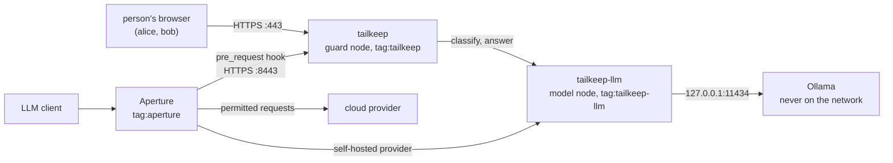

# tailkeep

tailkeep is a small Go program that checks text for secrets and sensitive content before it reaches a cloud model, and uses the caller's Tailscale identity to decide what happens next.

Built with tsnet, Tailscale's Go library for embedding a tailnet node in a program, it joins your tailnet as two nodes. The guard (`tailkeep`) finds sensitive content and applies the policy of whoever is asking. The model node (`tailkeep-llm`) is a reverse proxy in front of a local Ollama, reachable only by callers the policy allows. People use the guard through a web app, and Aperture can call it as a `pre_request` hook.

Users never log in and never hold a key. The tailnet tells tailkeep who is calling, and an app capability in the policy file says how that caller is to be treated.

tailkeep does not try to out-detect other tools. Its pattern detectors are a short fixed list. The part it adds is the wiring on Tailscale: callers are identified by the tailnet, policy lives in grants, the local model can be reached only over the tailnet, and Aperture can consult tailkeep before it forwards a request. Other tools are named under [Related tools](#related-tools).

## What you will see

With the example policy in [examples/policy.example.hujson](examples/policy.example.hujson), the same text containing a fake AWS key gives a different result for each caller:

| Caller | Result |
|---|---|
| `alice@example.com` (action `reroute`) | finding `aws_access_key`; the web app lets her ask the local model about the text, and the answer never leaves the tailnet |
| `bob@example.com` (action `block`) | finding `aws_access_key`; the text is not sent to any model for an answer |
| `alice@example.com` (action `reroute`), through Aperture to a cloud model | blocked with 451 "Sensitive content found (aws_access_key). Send this request to granite4.1:3b instead."; re-sent to the local model, it is allowed |
| a device with no `llm` grant, calling the model node | `403`, naming the device |

## How it works



Every request to the web app, the hook and the model node follows the same order, written as one short function per entry point (`scan`, `answer`, `handle`, `ServeHTTP`):

1. Resolve identity. WhoIs on the connection gives the caller's login or tags, device name and the tailkeep capabilities it holds toward this node.
2. Load the policy from those capabilities (see [Policy reference](docs/policy.md#policy-reference)).
3. Detect. The built-in detectors scan all of the text. If the policy has `model_check` on and no detector found anything, the local model also classifies the first 2,000 characters.
4. Decide. The policy turns findings and classification into one action.
5. Audit and respond. One audit line is written (never the text), then the answer is sent.

The four actions:

| Action | Cloud model | Local model |
|---|---|---|
| `allow` | receives the text as written | may receive it |
| `redact` | receives the text with every finding swapped for a `[REDACTED:<detector>]` marker | may receive it |
| `reroute` | receives nothing. The web app has the local model answer instead; through Aperture the request is refused with a note telling the sender to use the local model (see [Using it with Aperture](docs/aperture.md#using-it-with-aperture)) | may receive it |
| `block` | receives nothing | is not asked for an answer. The local classifier may still read the first 2,000 characters when `model_check` is on |

"Block" means the text is not sent to any model for an answer, not that no model reads it. The full note is in [docs/detectors-and-model.md](docs/detectors-and-model.md#a-note-on-block).

Running two nodes from one program gives each its own address, tags and grants. That lets the policy admit Aperture to the model node and nobody else, and lets the guard call the model node as an ordinary peer.

Measured live on a real tailnet: the hook takes 0 to 1 ms inside tailkeep (about 310 ms end to end through [Aperture](docs/aperture.md#using-it-with-aperture)), a policy change reached tailkeep in about 1 to 2 seconds with no restart ([policy](docs/policy.md#policy-reference)), and the local model check scored 17 of 20 with no false positives ([why this model](docs/detectors-and-model.md#why-this-model)).

## Quick start

You need Go 1.27.1 or later (the version `tailscale.com` requires). Nothing else is needed for the first part.

### Offline: tests and the `check` command

```sh
go test ./...
```

The tests never need a network, a tailnet, Ollama or Aperture. `check` reads text from standard input and prints the decision for a policy action (`--action`, default `block`), without the network. The key below is the public AWS documentation example, assembled in the shell so this file holds no key-like string:

```sh
printf 'aws_access_key_id = %s%s\n' AKIA IOSFODNN7EXAMPLE | go run ./cmd/tailkeep check --action block
```

```
findings: 1
  aws_access_key [20,40) AKIA…
decision: block (found aws_access_key)
```

### The full app

You need a tailnet with MagicDNS and HTTPS certificates enabled, Ollama running on the same machine, and permission to edit the tailnet policy file.

1. **Policy.** Merge the tags, grants and app grants from [examples/policy.example.hujson](examples/policy.example.hujson) into your policy file. At minimum you need the tags, the network grants, and the tailkeep app grants for the people you want to try.
2. **Auth keys.** Create two reusable, pre-approved, non-ephemeral auth keys, one tagged `tag:tailkeep` and one tagged `tag:tailkeep-llm`. Export them for the first start only:
   ```sh
   export TS_AUTHKEY_GUARD=<key tagged tag:tailkeep>
   export TS_AUTHKEY_LLM=<key tagged tag:tailkeep-llm>
   ```
3. **Ollama and the model.** Install Ollama and pull `granite4.1:3b`.
4. **Doctor.** `go run ./cmd/tailkeep doctor` checks each step in order, stops at the first failure and prints a fix.
5. **Serve.** `go run ./cmd/tailkeep serve`, then open `https://tailkeep.<tailnet>.ts.net`. Paste text, press Check, and if the action is not `block`, ask a question about it. The audit page is at `/audit`.

Flags, certificate timings and setup notes: [policy](docs/policy.md#command-line-flags-and-first-start), [troubleshooting](docs/troubleshooting.md#notes-from-the-quick-start), [`check`](docs/testing.md#the-check-command).

## Reading the code

Start with these functions; the rest of the code supports them.

- [internal/web/web.go](internal/web/web.go) `ServeHTTP`: the web app's router, with the Host and cross-site checks. Its `scan` (POST /api/scans) is the whole path of one check.
- [internal/web/answer.go](internal/web/answer.go) `answer`: POST /api/answers, the same path plus asking the local model; a block returns before the model.
- [internal/hook/hook.go](internal/hook/hook.go) `handle`: the Aperture hook, from caller and end user to decision and response.
- [internal/llmproxy/llmproxy.go](internal/llmproxy/llmproxy.go) `(*Proxy).ServeHTTP`: the model node, which checks the `llm` grant, the method and path and the size before it forwards.
- [internal/policy/policy.go](internal/policy/policy.go) `Merge` and `Decide`: how grants combine into one policy, and how findings turn into an action.
- [internal/detect/detect.go](internal/detect/detect.go) `Detect`: runs every detector over the text and returns the findings in order.

## Security model

Each point is explained in [docs/security.md](docs/security.md#protections); [12 claims](docs/security.md#induced-failure-checks) are backed by tests.

- Hook and model node are protected twice: by the network grant and by the capability check.
- No API keys: the only secrets are two tagged auth keys, never logged.
- Deny by default: no capability means `block`.
- Strictest wins when grants overlap; permissions add up.
- Unknown stays unknown: a model failure is never `clean`.
- The model node serves inference only; management paths are `404`.
- TLS only, no plain-HTTP listener.
- Secrets are never logged; the audit file is mode 0600.
- Tags come from the control plane, never from the user profile.
- Cross-site protection on the web app: Host and Origin checks, a strict Content-Security-Policy.

Main limits (see also [out of scope](docs/security.md#out-of-scope)):

- Detection is a short list of patterns plus a best-effort local model that can be talked out of a verdict ([details](docs/detectors-and-model.md#the-local-model)).
- Only requests are scanned, not responses, and encoded secrets or secrets inside images and files are not found ([hook limits](docs/aperture.md#using-it-with-aperture)).
- There is no rate limit; use network grants to decide who can reach the web app ([endpoints](docs/policy.md#web-app-endpoints)).

## Documentation

[Policy](docs/policy.md), [detectors and model](docs/detectors-and-model.md), [Aperture](docs/aperture.md), [security](docs/security.md), [testing](docs/testing.md), [troubleshooting](docs/troubleshooting.md), [gate tally](docs/gate-tally.md).

## Related tools

Several open source projects work on parts of this problem: Microsoft Presidio for personal data, LLM Guard for checks on prompts and replies, and secret scanners such as gitleaks. Each has a scope and a track record of its own and deserves its own evaluation. tailkeep's detectors are a short built-in list. The code has no plug-in mechanism for other engines today.

## Extending it

These are ideas. None of them exists in the code.

- A Docker Compose setup (an Ollama container plus tailkeep, CPU by default) to try tailkeep without installing anything on the host.
- Pluggable detector backends, such as Presidio or LLM Guard, behind a detector interface shared by the web app and the hook. Today only the web package has a small interface, and the hook calls the built-in detectors directly.
- Tailscale Services (`ListenService`) so several guard instances can share one name.
- Device posture: a stricter action for unmanaged devices.
- `tsidp` for identity in other tools.
- Shipping the audit file to a log pipeline.

## License

BSD-3-Clause. See [LICENSE](LICENSE).
